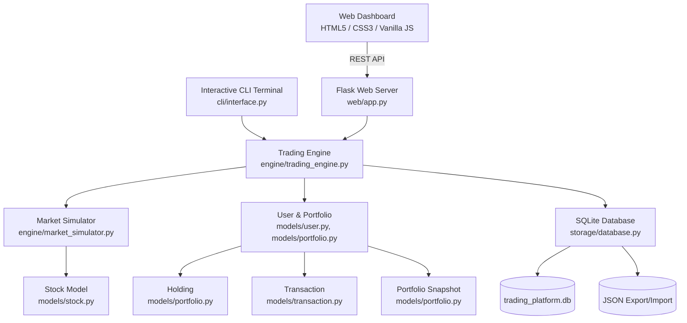

# 📈 Quantum Trade - Advanced Stock Trading Platform

A full-featured simulated stock trading and portfolio performance tracking platform built with **Python 3**, featuring an **Object-Oriented Architecture (OOP)**, **Stochastic Market Dynamics**, **Dual Interfaces (Modern Web Dashboard + Interactive CLI)**, **Relational SQLite Persistence**, and **JSON Data Export/Import**.

---

## 🌟 Key Features

1. **Object-Oriented Programming (OOP) Architecture**:
   - [`Stock`](models/stock.py): Encapsulates ticker details, stochastic price movements (Geometric Brownian Motion), 24h high/low tracking, volume, bid/ask spread, and price history points.
   - [`Transaction`](models/transaction.py): Immutable record of order executions (`BUY` / `SELL`) with shares, execution prices, fees, timestamps, and audit IDs.
   - [`Portfolio`](models/portfolio.py): Tracks cash balances, active stock holdings (`Holding`), average cost basis, realized P&L, unrealized P&L, asset allocation breakdown, and historical valuation snapshots (`PortfolioSnapshot`).
   - [`User`](models/user.py): Manages user identity, associated portfolio, and stock watchlists.
   - [`MarketSimulator`](engine/market_simulator.py): Real-time exchange simulation engine supporting market sentiment regimes (*Bullish Rally*, *Bearish Selloff*, *High Volatility*, *Neutral*).
   - [`DatabaseManager`](storage/database.py): Relational storage in SQLite (`data/trading_platform.db`) and backup/restore via JSON.
   - [`TradingEngine`](engine/trading_engine.py): Central coordinator coordinating orders, order matching/validation, auto-snapshotting, and market ticks.

2. **Dual User Interfaces**:
   - **Modern Web Dashboard**: Sleek, dark-mode financial terminal (Bloomberg / TradingView aesthetic) with live ticker marquee, interactive canvas charts for **Portfolio Performance Over Time** and **Stock Price History**, asset allocation visualization, real-time buy/sell modal with instant calculations, and transaction audit table.
   - **Interactive Terminal (CLI)**: Colorful command-line interface with formatted ASCII tables, deep-dive quotes, buy/sell workflows, simulation steppers, and persistence management.

3. **Stochastic Market Simulation**:
   - Continuous price discovery modeled with Geometric Brownian Motion (drift + volatility + random normal shocks + micro-news events).
   - Live ticker tape with real-time green/red flashes on price changes.
   - Controllable market sentiment and auto-tick speed (1s, 2.5s, 5s).

4. **Portfolio Performance Tracking Over Time**:
   - Automatically captures timestamped portfolio snapshots on every market tick and trade execution.
   - Tracks Net Worth progression over time against the initial starting capital baseline ($50,000.00).
   - Detailed position breakdown: Shares, Average Cost, Current Market Price, Valuation, Unrealized P&L ($ and %), and Portfolio Weight (%).

5. **Full Persistence & Data Portability**:
   - **SQLite Database** (`data/trading_platform.db`): Relational storage of users, portfolios, open holdings, completed transactions, and valuation history.
   - **JSON Export / Import**: Download and upload complete portfolio backups with one click.

---

## 🏗 System Architecture



---

## 🚀 Quick Start Guide

### Prerequisites
- Python 3.10+ (tested on Python 3.13)
- Dependencies: `Flask`, `colorama` (pre-installed in standard environments)

### 1. Launch Modern Web Trading Dashboard (Default)
```bash
python main.py
```
Or specify a custom port:
```bash
python main.py --port 8080
```
This automatically starts the server and opens `http://127.0.0.1:5000` in your web browser.

### 2. Launch Interactive Terminal (CLI)
```bash
python main.py --cli
```
Features a colorized interactive terminal menu with live quotes, order execution, simulation controls, and persistence.

### 3. Run Comprehensive Test Suite
```bash
python main.py --test
# or
python -m unittest tests/test_trading.py
```
Validates financial math, order execution, fund validation, realized/unrealized P&L, SQLite persistence, and JSON backup/restore.

---

## 📁 Project Directory Structure

```
Stock-Trading-Platform/
├── data/                       # SQLite database & JSON export backups
│   └── trading_platform.db
├── models/                     # OOP Domain Models
│   ├── __init__.py
│   ├── stock.py                # Stock class with stochastic Brownian pricing
│   ├── transaction.py          # Transaction class (BUY/SELL order audit)
│   ├── portfolio.py            # Portfolio, Holding & PortfolioSnapshot classes
│   └── user.py                 # User class with watchlist & settings
├── engine/                     # Simulation & Orchestration Engine
│   ├── __init__.py
│   ├── market_simulator.py     # Market tick simulation & sentiment regimes
│   └── trading_engine.py       # Core coordinator between market, user & storage
├── storage/                    # Persistence Layer
│   ├── __init__.py
│   └── database.py             # SQLite relational manager & JSON exporter/importer
├── cli/                        # Terminal User Interface
│   ├── __init__.py
│   └── interface.py            # Colorized interactive terminal console
├── web/                        # Web Dashboard & REST API
│   ├── app.py                  # Flask REST API server
│   ├── templates/
│   │   └── index.html          # Semantic HTML5 trading terminal layout
│   └── static/
│       ├── css/
│       │   └── style.css       # Premium dark-mode glassmorphic styling
│       └── js/
│           └── app.js          # Client state, Canvas charting & auto-tick
├── tests/                      # Unit & Integration Tests
│   ├── __init__.py
│   └── test_trading.py         # Test cases for OOP models, math & persistence
├── main.py                     # Unified CLI / Web / Test entry point
└── README.md                   # System documentation
```

---

## 📡 REST API Reference

| Endpoint | Method | Description |
|---|---|---|
| `/` | `GET` | Main trading terminal interface |
| `/api/market` | `GET` | Live quotes for all listed stocks, index change & volume |
| `/api/market/tick` | `POST` | Advance simulation by N ticks (`{"steps": 1}`) |
| `/api/market/sentiment` | `POST` | Change sentiment (`{"sentiment": "bullish"\|"bearish"\|"volatile"\|"neutral"}`) |
| `/api/stock/<symbol>` | `GET` | Deep-dive quote and historical price array for charting |
| `/api/portfolio` | `GET` | Active user portfolio, holdings, P&L, and snapshots |
| `/api/trade/buy` | `POST` | Execute market BUY order (`{"symbol": "AAPL", "quantity": 10}`) |
| `/api/trade/sell` | `POST` | Execute market SELL order (`{"symbol": "AAPL", "quantity": 5}`) |
| `/api/user/deposit` | `POST` | Deposit funds (`{"amount": 10000}`) |
| `/api/user/switch` | `POST` | Switch active trader profile (`{"username": "sarah"}`) |
| `/api/watchlist/toggle`| `POST` | Add/remove stock from personal watchlist |
| `/api/export` | `GET` | Download full portfolio state as `.json` |
| `/api/import` | `POST` | Upload and restore portfolio from `.json` |

---

## 🧪 OOP Design Principles Highlight

- **Encapsulation**: Private state and internal calculation logic (e.g., cost basis, realized P&L, stochastic ticks) are strictly encapsulated within their respective classes.
- **Single Responsibility**: `Stock` handles price discovery; `Portfolio` manages capital, holdings, and snapshots; `Transaction` stores trade audit data; `DatabaseManager` handles SQL persistence.
- **Composition**: `User` contains a `Portfolio`, which contains `Holding` instances, a ledger of `Transaction` instances, and `PortfolioSnapshot` records.
- **Open/Closed**: The simulation engine can easily accommodate new asset classes, sentiment profiles, or order types without modifying existing models.
